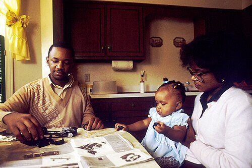
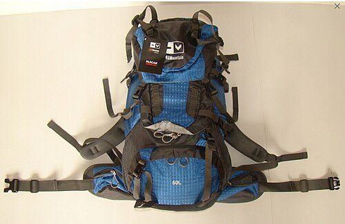
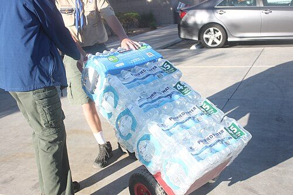
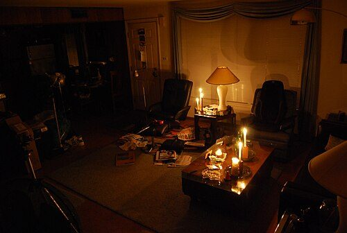
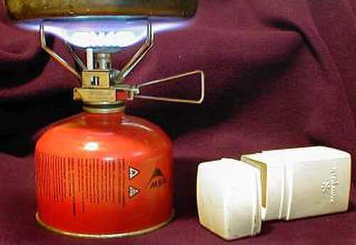
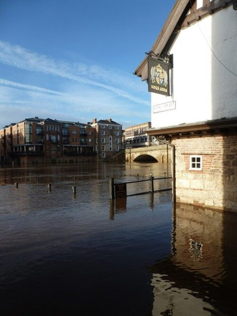
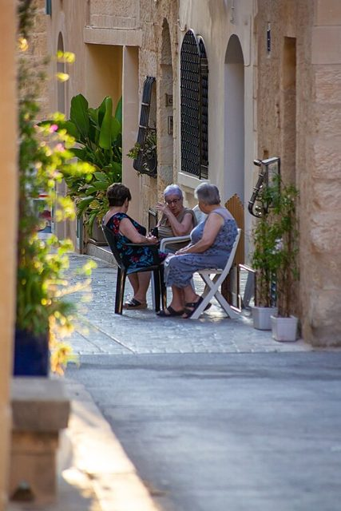

# Ready together: preparing as neighbours

Being ready for an emergency is not about hiding behind a locked door with a cupboard full of tins. It is about making sure your household can cope for a few days, and that your street can look after the people who would struggle. A flood, a long power cut, a heatwave or a pandemic all go better when neighbours already know each other and have a plan.

## Start with official advice

It is always worth seeing what advice governments give on being ready. In the UK, start with the government's [Be Ready campaign](https://beready.campaign.gov.uk/). It has a simple checklist, ways to help your community, and a link to the Priority Services Register for people who need extra help during a power or water cut.

The Church of Jesus Christ of Latter-day Saints (often called the Mormons) has long encouraged its members to prepare, and it shares a good range of practical [emergency preparedness resources](https://www.churchofjesuschrist.org/study/manual/gospel-topics/emergency-preparedness?lang=eng). They are worth a look whatever your beliefs.

## Keep a rolling store

Rather than putting food away and forgetting it until it goes off, keep a rolling store. Buy a little extra of the things you already eat, use the oldest first, and replace them as you go. That way your store is always fresh, nothing is wasted, and you are never more than a few days away from being ready. There will be more on this in our [Preserving and storing](/food/preserving/) guide.

## Our kit list

Most checklists cover water, food, a torch and a radio. Our [kit list](/be-ready/kit-list/) adds the things we have found useful that are often missed, from a Kelly Kettle to a pack of playing cards. We also suggest keeping a [travel bag](/be-ready/travel-bag/) packed and ready, a [holiday let box](/be-ready/holiday-box/) of the kitchen things holiday cottages always seem to lack, an [outdoor cooking box](/be-ready/cooking-box/) for hot food and drinks when the power is off, a [food box](/be-ready/food-box/) of simple meals that keep, a [bedding box](/be-ready/bedding-box/) for a good night's sleep wherever you end up, and a [dog box](/be-ready/dog-box/) so your dogs have what they need too.

## Guides we plan to include

- {: .item-img loading="lazy" width="64" height="64"} **A household plan.** What to talk about at home, where to meet if you are separated, and who to call.
- {: .item-img loading="lazy" width="64" height="64"} **A grab bag and a home store.** What to keep for a few days without power or water.
- {: .item-img loading="lazy" width="64" height="64"} **Water.** How much to store, how to keep it safe, and how to make water safe to drink.
- {: .item-img loading="lazy" width="64" height="64"} **Power cuts.** Lighting, keeping warm safely, keeping phones charged, and avoiding carbon monoxide poisoning.
- {: .item-img loading="lazy" width="64" height="64"} **Cooking without power.** Barbecues, stoves and fuel-efficient cooking.
- {: .item-img loading="lazy" width="64" height="64"} **Floods, storms and heatwaves.** What to do before, during and after.
- {: .item-img loading="lazy" width="64" height="64"} **Checking on others.** How to know who on your street might need help, and how to offer it without intruding.
- {: .item-img loading="lazy" width="64" height="64"} **Warm spaces and community hubs.** How a hall, meeting house or place of worship can open its doors in an emergency.

Guides coming soon.

See [Further reading](/further-reading/) for more websites and books.


