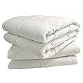
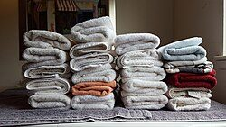

# The bedding box

A box of good bedding, packed and ready, means a comfortable night's sleep wherever you end up. It saves the extra charge many holiday lets make for linen, and it gives you something familiar on a strange bed. In an emergency it is even more useful: if you have to stay with friends, in a rest centre or a community hall, or take in someone who has had to leave their own home, warm bedding is one of the first things everyone needs. And in a long winter power cut, an extra duvet on every bed makes a big difference.

## What goes in our box

- {: .item-img loading="lazy" width="64" height="64"} **A duvet each.** Single duvets, rather than one double, so they fit any bed and anyone can use them.
- {: .item-img loading="lazy" width="64" height="64"} **Two good pillows each,** because a poor pillow ruins a night's sleep more than anything else.
- {: .item-img loading="lazy" width="64" height="64"} **Flat (non-fitted) sheets,** which fit any size of bed.
- {: .item-img loading="lazy" width="64" height="64"} **A sleep mask each,** for rooms with thin curtains, early summer mornings, or a hall where the lights stay on.
- {: .item-img loading="lazy" width="64" height="64"} **Four wool-blend army blankets,** which are cheap, hard-wearing and stay warm even when damp. Lay them over a duvet on a cold night, or use them on their own.
- {: .item-img loading="lazy" width="64" height="64"} **Two towels,** so you are not relying on wherever you end up to provide them.
- {: .item-img loading="lazy" width="64" height="64"} **Pyjamas and a bathrobe each,** for warmth and privacy, especially when sharing a house or a hall with others.
- {: .item-img loading="lazy" width="64" height="64"} **Flip-flops each,** for unfamiliar floors and shared bathrooms.
- **A large box or bag** to keep it all clean and dry.

## Tips

- Wash everything before you pack it, and make sure it is completely dry, so it does not smell musty when you open it.
- Vacuum storage bags shrink duvets and pillows to a fraction of their size, which helps if space is tight.
- Add duvet covers and pillowcases so the bedding is ready to use straight away.
- Air the box once or twice a year.

See also the [travel bag](/be-ready/travel-bag/), the [holiday let box](/be-ready/holiday-box/) and the [outdoor cooking box](/be-ready/cooking-box/).

## Download a checklist

[Download the bedding box checklist (Word, editable)](/assets/checklists/bedding-box-checklist.docx). It lists everything on this page with a tick box for each item and space to add your own. It opens in Word, Google Docs, Pages or LibreOffice. Print a copy and tape it inside the lid, then tick things off when you check or repack it.


