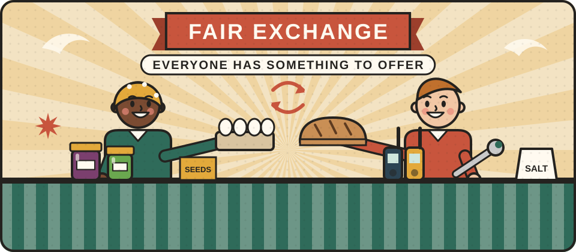
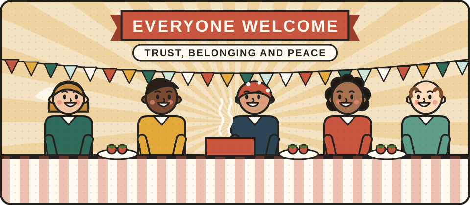

# Building a community that holds together

<blockquote class="verse">

Hail, ye Givers! a guest is come; 
say! where shall he sit within? 
Much pressed is he who fain on the hearth 
would seek for warmth and weal.

Hávamál, stanza 2, translated by Olive Bray (1908)

</blockquote>

A community rests on mutual need and mutual exchange. To be part of one, you need to have something to offer, and you need to be willing to accept something in return. Someone who only ever asks for help cannot build a community, and neither can someone who refuses help because they do not want to be in anyone's debt. The ties that hold a street together are made of small debts: the borrowed ladder, the lift to hospital, the jar of chutney left on a doorstep, each one remembered and, in time, returned.

Much of the work is keeping that balance, so that everyone feels useful and appreciated. Some people believe they have nothing to give, and part of building a community is helping them see what they can offer, whether that is time, a skill, a story or simply being around when others are out. Others feel they have everything and need no one. They need the people around them too, and taking part means being humble enough to accept help as well as give it.

<figure class="illustration"></figure>

Exchange builds a community, and plain dealing keeps it together. That means speaking directly, treating each other fairly and being honest, even when it is difficult. This matters for peace. Flattering people, or trying to please everyone, does not build trust that lasts. Being fair, honest and plain-spoken does, even when it means saying something unwelcome.

For preparing, it means thinking about what you keep. As well as things for your own household, keep things you can offer to others, such as extra salt, preserves, seeds or dried herbs. Keep things that are best shared and used together, too, such as radios, tools or a big cooking pot. These give people a part to play, and having a part to play is what makes someone belong.

Supplies and equipment only help if people trust each other enough to share them. This section is about the slower work of building that trust: getting to know neighbours, making sure no one is left out, giving young people something worthwhile to do, and learning to handle disagreement without it turning into hostility.

<figure class="illustration"></figure>

## Guides we plan to include

- **Getting started.** How to meet your neighbours and start a street or village group.
- **Running a good group.** Holding meetings people want to come to, sharing the work, and keeping volunteers.
- **Including everyone.** Reaching people who are isolated, new to the area, disabled or who do not speak English.
- **Young people.** Giving them real responsibility through projects, skills and mentoring.
- **Handling conflict.** Listening, mediation and calming tense situations, drawing on the Alternatives to Violence Project and restorative practice.
- **Checking what you read.** Spotting false stories and rumours before they spread or turn people against each other.
- **Welcoming newcomers.** Preparing to receive people fleeing conflict, as many did through Homes for Ukraine.
- **Links beyond your street.** Town twinning, language learning and friendships across borders.
- **Courage without weapons.** Stories of people who served, protected others and showed great bravery without bearing arms.

Guides coming soon.


