# The outdoor cooking box

When the power goes off, a hot drink and a hot meal make a bigger difference than almost anything else. An outdoor cooking box keeps everything you need to light a fire, boil water and cook a simple meal in one place, ready to carry out to the garden, a park or a campsite. It is just as useful for a day out, a camping trip or a barbecue that gets out of hand.

## What goes in our box

### The box itself

- **A waterproof box with a clip-shut lid,** so matches and fire starters stay dry

### Lighting a fire

- 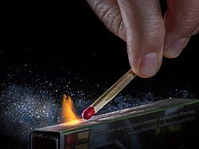{: .item-img loading="lazy" width="64" height="64"} Matches, in a waterproof container
- 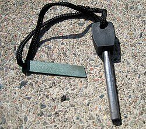{: .item-img loading="lazy" width="64" height="64"} A fire steel, which strikes sparks even when wet
- Fire starters. We recommend natural wood wool firelighters, such as Ecoblaze or similar: they light easily, have no chemical smell, and will not taint your food
- 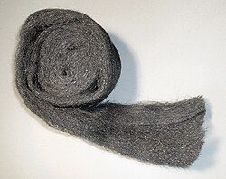{: .item-img loading="lazy" width="64" height="64"} Wire wool, which catches a spark easily and is also handy for scrubbing pans
- 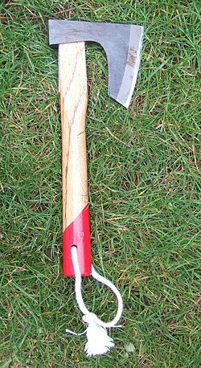{: .item-img loading="lazy" width="64" height="64"} A small hatchet, for splitting kindling

### Cooking and boiling

- 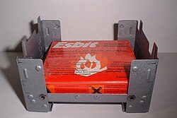{: .item-img loading="lazy" width="64" height="64"} A small folding stove with solid fuel tablets, light and simple to use
- 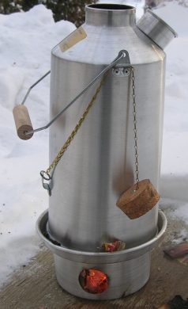{: .item-img loading="lazy" width="64" height="64"} A Kelly Kettle, which boils water fast on twigs, pine cones and scraps of paper
- 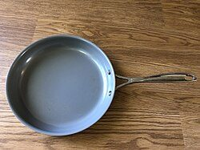{: .item-img loading="lazy" width="64" height="64"} A small frying pan
- 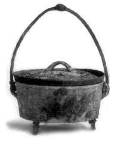{: .item-img loading="lazy" width="64" height="64"} A small cast-iron Dutch oven, with a trivet to stand it on over the fire, for stews, bread and slow cooking

### Seasoning

- 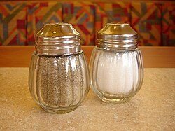{: .item-img loading="lazy" width="64" height="64"} Salt and pepper
- 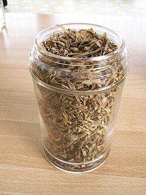{: .item-img loading="lazy" width="64" height="64"} Dried herbs, in small jars with tight lids

### Hot drinks

- 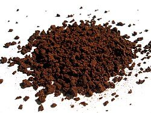{: .item-img loading="lazy" width="64" height="64"} Good instant coffee, for a decent cup that makes a hard day easier
- 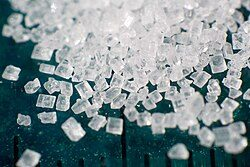{: .item-img loading="lazy" width="64" height="64"} Sugar, in a sealed tub

### Handling and seeing

- 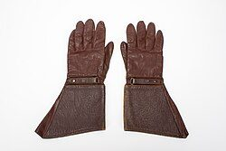{: .item-img loading="lazy" width="64" height="64"} A pair of welder's gloves, for moving hot pans, Dutch oven lids and burning logs
- 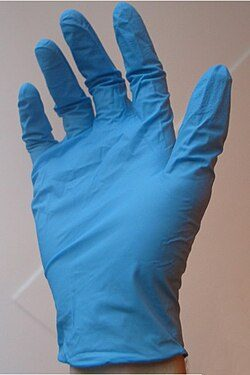{: .item-img loading="lazy" width="64" height="64"} Disposable nitrile gloves, for handling raw meat and keeping your hands clean when there is little water for washing
- 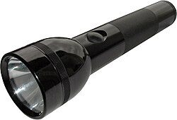{: .item-img loading="lazy" width="64" height="64"} A torch with a flat bottom, which stands upright on its end to light up your cooking area, or shines at the ceiling of a tent to light it like a lamp

Only ever cook outdoors, well away from doors and windows. Stoves, Kelly Kettles and fires give off carbon monoxide, which can kill without warning, so never use them inside a house, tent, caravan or garage. Keep water or a fire blanket nearby, check local rules before lighting a fire anywhere other than your own garden, and make sure every fire is completely out before you leave it. A hatchet is a tool: keep it packed in the box, not carried around in public.

## Tips

- Practise now. Lighting a fire with a fire steel, and cooking a decent meal in a Dutch oven, both take a few goes to get right.
- Check the box twice a year. Replace used fuel, fire starters, seasoning, coffee and sugar, and keep the matches dry.
- Season and oil cast-iron pans after use, so they do not rust in the box.

See also the [food box](/be-ready/food-box/), our [kit list](/be-ready/kit-list/) and the [holiday let box](/be-ready/holiday-box/).

## Download a checklist

[Download the outdoor cooking box checklist (Word, editable)](/assets/checklists/outdoor-cooking-box-checklist.docx). It lists everything on this page with a tick box for each item and space to add your own. It opens in Word, Google Docs, Pages or LibreOffice. Print a copy and tape it inside the lid, then tick things off when you check or repack it.


