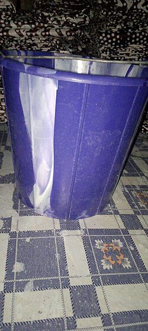
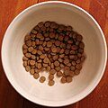
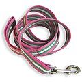
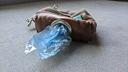
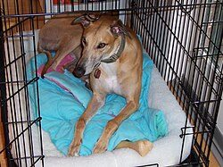
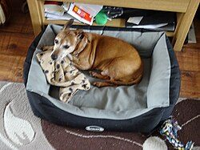
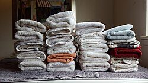

# The dog box

Dogs need looking after in an emergency as much as people do, and they cope far better with their own food, bowls and bed around them. A dog box keeps everything in one place, so if you have to leave home in a hurry, stay with friends or go away at short notice, you can pick it up with the dogs and go. It is just as handy for an ordinary holiday or a weekend away.

Many rest centres cannot take pets, so it is worth agreeing now with a friend or relative where your dogs could stay if you had to leave home.

## What goes in our box

- {: .item-img loading="lazy" width="64" height="64"} **A water bucket,** ideally a collapsible one, for drinking water on the move and wherever you stay.
- {: .item-img loading="lazy" width="64" height="64"} **A bowl for each dog,** so nobody has to share or wait.
- {: .item-img loading="lazy" width="64" height="64"} **Leads,** with a spare in case one breaks or goes missing.
- {: .item-img loading="lazy" width="64" height="64"} **Poo bags,** more than you think you will need.
- **Food for seven days,** in a sealed, airtight container.
- **A spare bag of their usual dry kibble,** kept sealed. It lasts well and saves a panic if you are away longer than planned.
- {: .item-img loading="lazy" width="64" height="64"} **A crate for each dog,** for travelling safely in the car and for somewhere calm and familiar to settle in a strange place. Folding crates take up the least space.
- {: .item-img loading="lazy" width="64" height="64"} **Bedding,** such as a blanket or vet bed for each dog, which smells of home.
- {: .item-img loading="lazy" width="64" height="64"} **Towels,** at least one per dog, for drying wet or muddy dogs before they get into the car or someone else's house.

## Tips

- Treat the food as a rolling store: use the oldest food in your everyday feeding and replace it with fresh, so the box never goes out of date.
- Stick to the food your dogs already eat. A sudden change of diet can upset their stomachs, which is the last thing you want on the move.
- Keep a note in the box of your vet's phone number, each dog's microchip number and any medicines they take, and a recent photo of each dog in case one goes missing.
- Make sure each dog wears a collar with an ID tag showing your name and address. This is a legal requirement in the UK, as is microchipping.

See also [first aid for pets](/health/pet-first-aid/), the [holiday let box](/be-ready/holiday-box/) and the [bedding box](/be-ready/bedding-box/).

## Download a checklist

[Download the dog box checklist (Word, editable)](/assets/checklists/dog-box-checklist.docx). It lists everything on this page with a tick box for each item and space to add your own. It opens in Word, Google Docs, Pages or LibreOffice. Print a copy and tape it inside the lid, then tick things off when you check or repack it.


