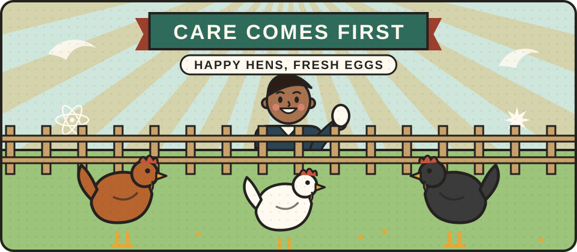

# Keeping animals

Hens, bees and other small animals can provide eggs, honey and more, but they need daily care and come with legal responsibilities. This section will cover how to keep animals for food responsibly, kindly and within the law.

<figure class="illustration"></figure>

## Can you help write this?

We are looking for experienced smallholders, poultry keepers, beekeepers and vets who can explain what is involved in keeping animals well. If that could be you, please [get in touch](/get-involved/).

## What we hope to cover

- Keeping hens for eggs, including registering your flock (in Great Britain, keepers of poultry must register them, however few birds they have)
- Bees and honey
- Rabbits, ducks and goats
- Feeding, housing and animal welfare
- Working with a vet, and the rules on keeping farm animals


