# The food box

A food box holds a few days of simple, filling meals that keep for months and need nothing more than a pan and some water. Pair it with the [outdoor cooking box](/be-ready/cooking-box/) and you can feed your household through a long power cut, or take it with you if you have to leave home. It is a start, not a full larder: add the things your household likes to eat.

## What goes in our box

The amounts below feed two adults for a week, with two hot meals and a breakfast each day. Scale them up or down for your household.

### The basics

- 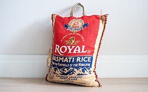{: .item-img loading="lazy" width="64" height="64"} **A bag of rice,** 3 kg, which keeps for a long time, cooks in one pot and goes with almost anything.
- 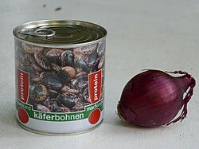{: .item-img loading="lazy" width="64" height="64"} **Tinned or dried beans,** 14 tins. Mix kidney, black-eyed and baked beans for variety. Tinned beans are ready to eat and need only warming through. Dried beans are lighter and cheaper but need soaking overnight and a long time cooking, which uses more fuel.
- 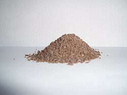{: .item-img loading="lazy" width="64" height="64"} **Gravy granules,** to turn rice and beans into a proper hot meal with very little effort.
- 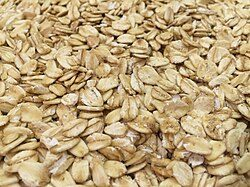{: .item-img loading="lazy" width="64" height="64"} **Porridge oats,** 1 kg, for breakfast.
- 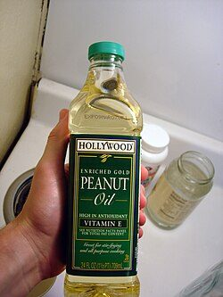{: .item-img loading="lazy" width="64" height="64"} **Cooking oil,** a small bottle. It adds a lot of energy for its size and makes everything taste better.

### To go with it

- {: .item-img loading="lazy" width="64" height="64"} **Hot dogs,** a jar or two.
- 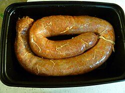{: .item-img loading="lazy" width="64" height="64"} **A whole cured chorizo,** which keeps unopened without a fridge.
- 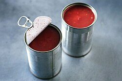{: .item-img loading="lazy" width="64" height="64"} **Chopped tomatoes,** 4 tins.
- {: .item-img loading="lazy" width="64" height="64"} **Coconut milk,** 2 tins.
- **Tinned sweetcorn,** a tin or two.

### Flavour

- 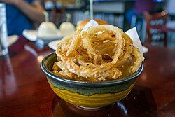{: .item-img loading="lazy" width="64" height="64"} **Dried onion flakes or crispy fried onions,** which keep far longer than fresh onions.
- 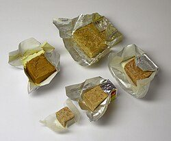{: .item-img loading="lazy" width="64" height="64"} **Stock cubes**
- 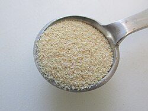{: .item-img loading="lazy" width="64" height="64"} **Garlic granules**
- 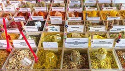{: .item-img loading="lazy" width="64" height="64"} **Spices:** cumin, chilli flakes, smoked paprika, curry powder and dried thyme.
- 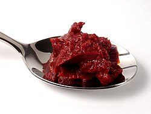{: .item-img loading="lazy" width="64" height="64"} **Tomato purée** in a tube.
- {: .item-img loading="lazy" width="64" height="64"} **Soy sauce and hot sauce**

### Snacks

- 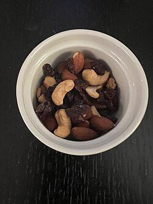{: .item-img loading="lazy" width="64" height="64"} **Peanut butter, nuts and dried fruit,** to top up energy between meals.

Dried red kidney beans contain a natural poison. Soak them, then boil them hard for at least 10 minutes before simmering them until soft. Never eat them raw or undercooked, and never cook them only in a slow cooker. Tinned kidney beans are already cooked and safe.

## Feeding two for a week

Two adults eating two hot meals a day for a week need 28 portions. Allow 100 g of dry rice per person per meal, which is a generous portion because rice is doing most of the work. That comes to 2.8 kg, so a 3 kg bag. Allow one 400 g tin of beans between two people per meal, which is 14 tins.

Rice and beans alone give each person roughly 950 kcal a day, about 700 from the rice and 250 from the beans. Most adults need between 2,000 and 2,500 kcal a day, so rice and beans fill you up but do not give you enough energy on their own. Porridge for breakfast, a spoonful of oil in each meal, and snacks such as peanut butter, nuts and dried fruit make up the difference.

Cooking 3 kg of rice takes about 7 litres of water, on top of what you need for drinking and washing. Plan for that if the water might be off as well as the power.

With the things in the box you can cook a different meal most days:

- **Chilli:** beans, chopped tomatoes, cumin, chilli flakes and smoked paprika.
- **Rice and peas:** kidney beans cooked into the rice with coconut milk and dried thyme.
- **Bean curry:** curry powder with chopped tomatoes or coconut milk.
- **Hot dogs and beans:** with gravy and crispy onions.
- **Smoky Spanish-style rice:** chorizo, smoked paprika and tomato purée.

Buy small tins and jars where you can. Without a fridge, anything opened is best eaten at one meal, so smaller tins mean less waste.

## Tips

- Keep it as a rolling store: use the oldest food in your everyday cooking and replace it, so nothing in the box goes out of date. See [keeping a rolling store](/be-ready/#keep-a-rolling-store).
- Pack a tin opener if your tins do not have ring pulls. Fresh onions keep for a few weeks somewhere cool and dark, so use them in everyday cooking and keep dried ones in the box.
- Store the box somewhere cool and dry, with dry food in airtight tubs to keep out damp and mice.
- Think about the people you would be feeding, including anyone with allergies or who does not eat meat.

See also the [outdoor cooking box](/be-ready/cooking-box/), our [kit list](/be-ready/kit-list/) and [Preserving and storing](/food/preserving/).

## Download a checklist

[Download the food box checklist (Word, editable)](/assets/checklists/food-box-checklist.docx). It lists everything on this page with a tick box for each item and space to add your own. It opens in Word, Google Docs, Pages or LibreOffice. Print a copy and tape it inside the lid, then tick things off when you check or repack it.


