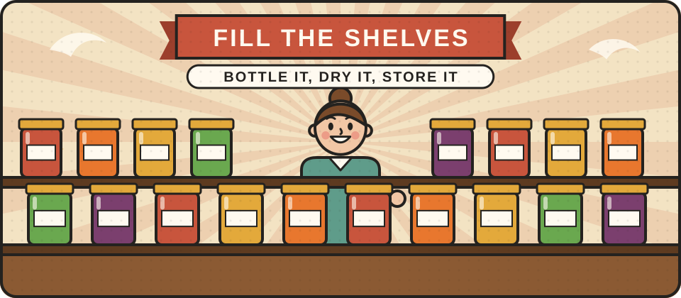

# Preserving and storing food

A good harvest or a cheap bulk buy is only useful if it keeps. This section will cover how to keep food safe and make it last, from a rolling store in your kitchen cupboard to making a harvest last through the winter.

<figure class="illustration"></figure>

## Can you help write this?

We are looking for experienced cooks, preservers, smallholders and people trained in food safety who can explain how to store and preserve food safely at home. If that could be you, please [get in touch](/get-involved/).

## What we hope to cover

- Building a rolling store you actually use, so nothing goes to waste
- Drying, pickling, fermenting and making jams and chutneys
- Bottling and canning safely
- Storing root crops, apples and grain without a fridge
- Food safety, and how to tell when food has gone off


