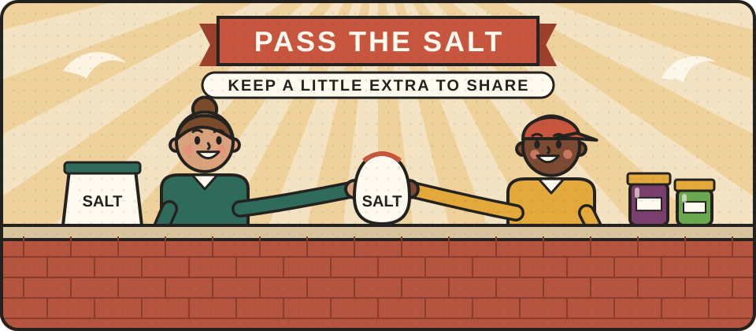
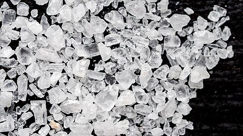
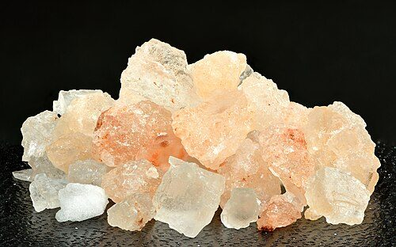
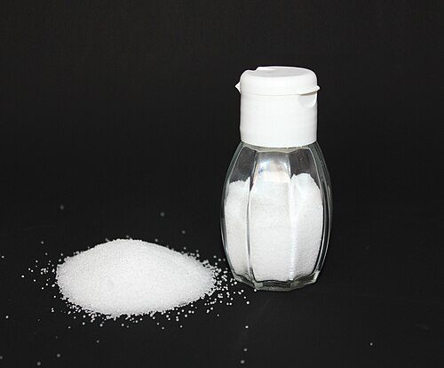
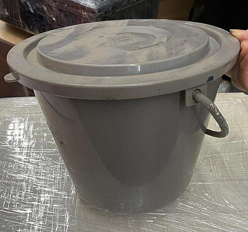
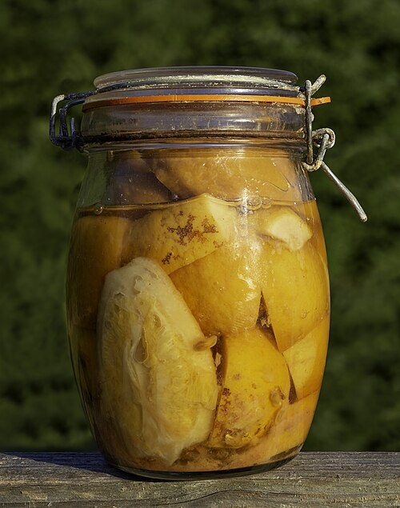
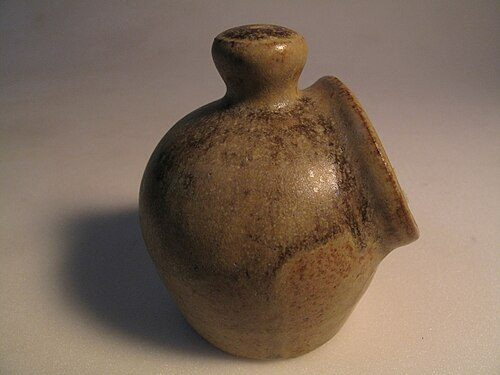
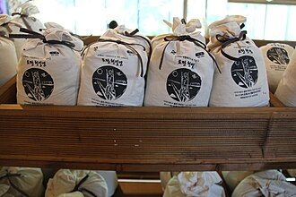

# Preserving and storing food

A good harvest or a cheap bulk buy is only useful if it keeps. This section will cover how to keep food safe and make it last, from a rolling store in your kitchen cupboard to making a harvest last through the winter.

<figure class="illustration"></figure>

## Can you help write this?

We are looking for experienced cooks, preservers, smallholders and people trained in food safety who can explain how to store and preserve food safely at home. If that could be you, please [get in touch](/get-involved/).

## What we hope to cover

- Building a rolling store you actually use, so nothing goes to waste
- Drying, pickling, fermenting and making jams and chutneys
- Bottling and canning safely
- Storing root crops, apples and grain without a fridge
- Food safety, and how to tell when food has gone off

## Salt

Salt is cheap, never goes off and is one of the few ways to keep food without a fridge or freezer. It is used for fermenting cabbage into sauerkraut, brining vegetables, and curing meat and fish. It also makes plain stored food like rice, beans and oats far more pleasant to eat.

<figure class="illustration"></figure>

<figure><figcaption>Coarse sea salt</figcaption></figure><figure><figcaption>Rock salt</figcaption></figure><figure><figcaption>Table salt</figcaption></figure>

### How much to keep

As a rough guide for two people for a year:

| Use | Amount |
| --- | --- |
| Cooking and the table | 1 to 2 kg |
| Fermenting and pickling | 2 to 5 kg |
| Curing meat or fish | 5 to 15 kg, depending on how much you do |

Curing uses more salt than most people expect: salting fish the traditional way can take almost as much salt as fish. For most households, 10 kg is plenty. If you plan to cure a lot, or to share, a 25 kg sack is not excessive.

### How to store it

<figure><figcaption>A lidded plastic bucket</figcaption></figure><figure><figcaption>A clip-top glass jar</figcaption></figure><figure><figcaption>A salt pig for the kitchen</figcaption></figure><figure><figcaption>Salt in cloth bags</figcaption></figure>

- Buy food-grade salt in bulk. A 25 kg sack of coarse sea salt, pickling salt or pure dried vacuum salt costs far less per kilo than supermarket tubs.
- For preserving, use pure salt. Most table salt contains anti-caking agents, which can cloud brine and sometimes upset ferments. Table salt is fine for cooking.
- Decant it into a food-grade plastic bucket with a tight lid. A 20 litre bucket holds about 20 to 25 kg. Use plastic or glass, not metal, because salt corrodes tins and steel drums.
- Keep a small jar or a salt pig in the kitchen and top it up from the bucket, so the main store stays sealed. A salt pig is a glazed pot with a wide opening at the front, which keeps salt dry and easy to reach while you cook.
- Store it somewhere dry, such as a cupboard or a shelf, rather than a damp garage or on a concrete floor. Salt draws in moisture and sets into a lump. If it does, break it up: it is still fine to use.
- Label it clearly, and keep it well apart from gritting salt for icy paths, which is not safe to eat.

A barrel only makes sense as a shared store for a street, an allotment group or a meeting house. Even then, two or three buckets are easier to move and share out.

## Keep a little extra to share

When you stock up on salt, dried herbs or preserves, it is worth keeping a little more than your household needs. In hard times, a bag of salt for a neighbour's pickling, a jar of dried herbs for someone cooking from a food bank parcel, or a jar of jam for someone who has had a bad week does far more than its price suggests. It starts conversations and builds the kind of trust that holds a street together.

This is also how preserving has always worked. Gluts were swapped over the fence, salt was traded, and jams and chutneys were made in batches and given away. If you make preserves, make an extra jar or two. If you have a salt bucket, let your neighbours know they can ask. Our [Community](/community/) section has more on building those links.


