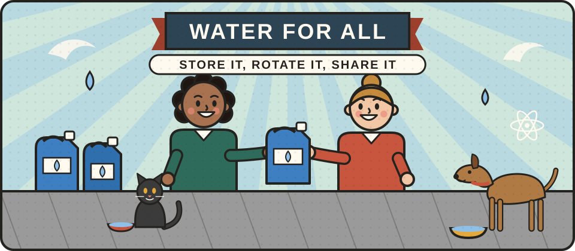
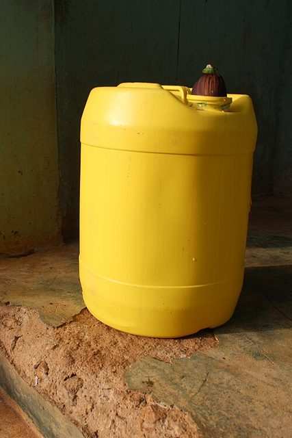
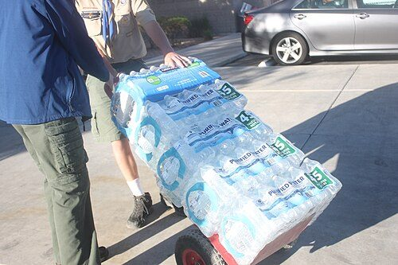
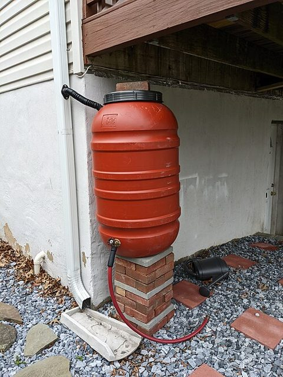
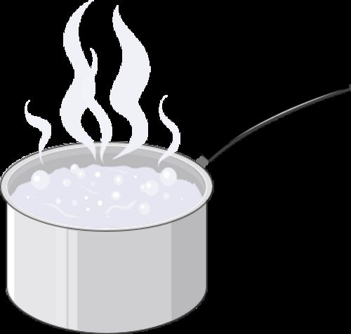
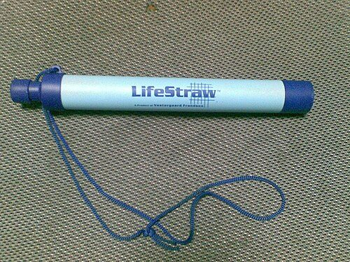

# Storing water for emergencies

You can go weeks without food but only a few days without water. Burst mains, floods, drought and long power cuts can all leave taps dry or the water unsafe to drink, sometimes with no warning. A small store of clean water, kept in the right containers and changed regularly, is one of the simplest and most useful things a household can do to be ready.

<figure class="illustration"></figure>

## How much you need

The UK government's [Be Ready](https://beready.campaign.gov.uk/) advice is to keep at least 3 litres of drinking water per person per day, for three days. That covers drinking only. Once you add cooking and keeping clean, 5 litres per person per day is a more realistic figure.

### Per person

| Use | Per day | For 3 days |
| --- | --- | --- |
| Drinking | 3 litres | 9 litres |
| Cooking, such as rice, pasta and porridge | 1 litre | 3 litres |
| Washing hands, brushing teeth and washing up | 1 litre | 3 litres |
| **Total per person** | **5 litres** | **15 litres** |

Rice needs about twice its own volume of water to cook, and dried beans need water for soaking as well as cooking, so allow more if your [food box](/be-ready/food-box/) leans on them. Allow more in hot weather, for anyone who is ill, and for anyone pregnant or breastfeeding.

### Pets

Dogs drink roughly 50 to 60 ml for each kilo they weigh every day, and more in hot weather or if they eat dry food. Cats drink much less, especially if they eat wet food.

| Animal | Per day | For 3 days |
| --- | --- | --- |
| Small dog, under 10 kg | 0.5 litres | 1.5 litres |
| Medium dog, 10 to 25 kg | 1 litre | 3 litres |
| Large dog, over 25 kg | 1.5 to 2 litres | 5 to 6 litres |
| Cat | 0.25 litres | about 1 litre |

### A worked example

Four people and one medium-sized dog need 4 × 15 litres plus 3 litres, which is 63 litres for three days: just over three 20 litre cans.

The amounts for washing do not include flushing the toilet. Use bath water, washing-up water or a water butt for that, not your drinking store.

## Keep twice as much, so you can help others

We suggest storing double the amount your own household needs. Outages often last longer than three days, and when they happen, the people who struggle most are often older neighbours, people who cannot carry heavy bottles, families with babies, and anyone who did not have the chance to prepare. A spare can of water handed over the fence is one of the most practical kindnesses there is, and it is exactly the kind of exchange that builds a [community](/community/).

For the household in the example above, that means 126 litres, or six or seven 20 litre cans.

## The best containers

<figure><figcaption>A plastic jerrycan. Choose a food-grade one</figcaption></figure><figure><figcaption>Stackable water containers</figcaption></figure><figure><figcaption>Sealed bottled water</figcaption></figure>

1. **Food-grade jerrycans, 10 to 20 litres.** The best main store for most homes. They are cheap to fill from the tap, stack well, and can be carried to the car or a neighbour. Choose blue or opaque ones marked as food-safe or for drinking water. A litre of water weighs a kilo, so a mix of 10 and 20 litre cans means everyone in the house can carry one.
2. **Sealed bottled water.** The best back-up. There is no cleaning or filling, it lasts until its best-before date (usually a year or two), and it is easy to hand out or put in a grab bag. It costs more and creates plastic waste, so rotate it through your everyday use.
3. **Stackable water boxes and larger drums.** Good if you want to store more than a week's worth, or for a shared community store. Once full, a 60 litre drum cannot be moved, so you will need a tap or a pump.
4. **A bath bladder.** A large bag that sits in the bath and fills from the taps. Useful if a water cut is announced in advance, and cleaner than an open bath, but no help if the water goes off without warning.

Avoid old milk bottles, which cannot be cleaned properly and split; anything that has held chemicals, fuel or cleaning products; and clear containers kept in the light, where algae will grow.

## Filling and looking after your store

- Before first use, clean new containers with a sterilising solution such as Milton, or a weak mix of unscented bleach, and rinse well.
- Fill them from the cold kitchen tap, which comes straight from the mains, not from a tap fed by a tank in the loft.
- Fill each container to the top so there is little air inside, and screw the cap on tight. If it will be kept somewhere that might freeze, leave a small gap for the water to expand.
- Write the date on each container, or set a reminder on your phone.
- Change tap water you have stored yourself every six months, or every three months if it is kept somewhere warm. Clean, sealed tap water does not go bad straight away, but the chlorine in it fades over time and the risk of anything growing slowly rises.
- Do not waste the old water. Use it for the garden, washing or flushing.
- Once a container is opened, use it within a day or two.

## Where to keep it

The best place is inside, somewhere cool and dark: a cupboard, under the stairs or under a bed. A cellar is ideal, because it stays cool and frost-free all year.

You can keep water in a shed, garage or yard, but heat, sunlight and frost all cause problems. Sunlight breaks down plastic and lets algae grow. Heat speeds up the growth of bacteria and gives the water a stale, plasticky taste. Frost can split a full container. If your store has to go outside:

- choose the coolest, shadiest spot, such as against a north-facing wall, and never a greenhouse or polytunnel
- cover it with a lidded box or a tarp to keep the light off
- stand it on a pallet or bricks, not straight on the ground
- keep it well away from petrol, oil, paint and weedkiller, because plastic picks up their smell and taste
- leave a small gap at the top of each container over winter, or bring them in during cold snaps
- change the water more often in summer

## Water you already have

- **The bath and pans.** If a cut is announced, fill the bath and a few large pans. Bath water is fine for flushing toilets and washing.
- **The hot water cylinder.** If you have one, it holds drinkable water. Turn off its heating first, and drain it from the tap at the bottom.
- **The toilet cistern.** Fine for washing if there is no cleaning block or chemical in it.
- **A water butt.** Rainwater from a downpipe is free water for flushing, washing and the garden. Boil or filter it before drinking.

<figure><figcaption>A water butt on a downpipe</figcaption></figure>

## Making water safe to drink

<figure><figcaption>Boil for at least a minute</figcaption></figure><figure><figcaption>A filter straw</figcaption></figure>

If you are unsure about water, from your store, a water butt or anywhere else:

- **Boil it.** Bring it to a full rolling boil for at least one minute, then let it cool. This is the most reliable method.
- **Use purification tablets,** following the instructions on the packet.
- **Use a filter,** such as a filter straw or bottle (see our [kit list](/be-ready/kit-list/)). Filters remove germs but most do not remove chemicals, so do not use them on water that may be contaminated with fuel or floodwater.

If your water company issues a "boil water" or "do not drink" notice, follow it.

## If someone in your home needs extra help

If anyone in your household is older, disabled, has a medical condition or has a young baby, sign up to your water company's Priority Services Register. Water companies use it to deliver bottled water to the people who need it most during an outage. It is free, and your energy supplier runs a similar register.


