# The holiday let box

Anyone who has stayed in a holiday cottage, a gîte or a caravan knows the feeling: the kitchen has six wine glasses but no corkscrew, the knives would not cut butter, and there is no peeler in sight. A holiday let box solves that. It is one sturdy box, kept packed with the things holiday kitchens always seem to lack, that goes straight into the car whenever you go away.

It is also good practice for being ready. The same box will serve you well if you ever have to stay somewhere unfamiliar at short notice, whether that is a friend's spare room, a church hall or a temporary home.

## What goes in our box

### The box itself

- **A strong plastic box with clip-shut lid,** big enough to hold everything below and to stack in the car boot

### Preparing food

- 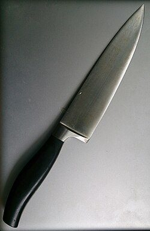{: .item-img loading="lazy" width="64" height="64"} A sharp cooking knife, with a blade guard
- 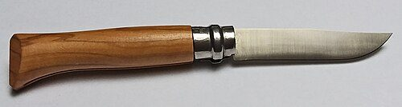{: .item-img loading="lazy" width="64" height="64"} An Opinel knife (keep it packed in the box: it locks, so it cannot be carried in public without a good reason)
- 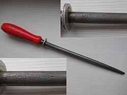{: .item-img loading="lazy" width="64" height="64"} A knife sharpener
- 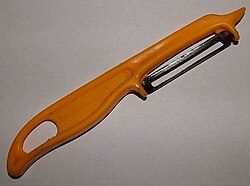{: .item-img loading="lazy" width="64" height="64"} A good potato peeler
- 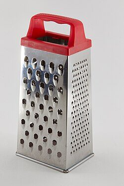{: .item-img loading="lazy" width="64" height="64"} A cheese grater
- 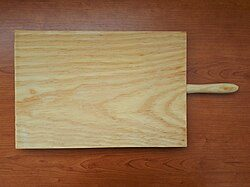{: .item-img loading="lazy" width="64" height="64"} A cutting board
- 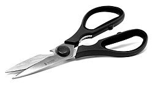{: .item-img loading="lazy" width="64" height="64"} Scissors
- 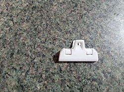{: .item-img loading="lazy" width="64" height="64"} Clips to close opened packets
- 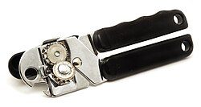{: .item-img loading="lazy" width="64" height="64"} A tin opener
- 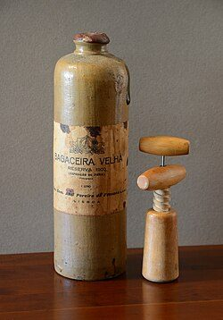{: .item-img loading="lazy" width="64" height="64"} A corkscrew and a bottle opener
- 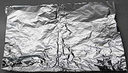{: .item-img loading="lazy" width="64" height="64"} Tin foil

### Seasoning

- 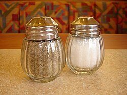{: .item-img loading="lazy" width="64" height="64"} Salt and pepper
- 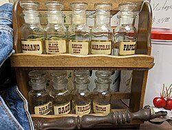{: .item-img loading="lazy" width="64" height="64"} Small jars of your favourite spices
- 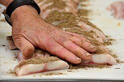{: .item-img loading="lazy" width="64" height="64"} Rubs for meat, fish or vegetables

### Eating and drinking

- 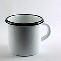{: .item-img loading="lazy" width="64" height="64"} Tin plates, cups and bowls, which do not break
- 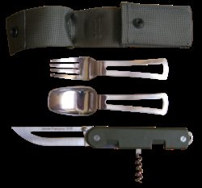{: .item-img loading="lazy" width="64" height="64"} Cutlery
- 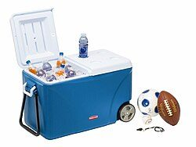{: .item-img loading="lazy" width="64" height="64"} A small cool box

### Washing up and keeping clean

- 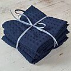{: .item-img loading="lazy" width="64" height="64"} Tea towels
- 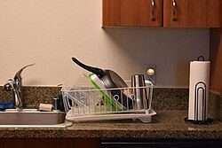{: .item-img loading="lazy" width="64" height="64"} A folding dish-drying rack
- 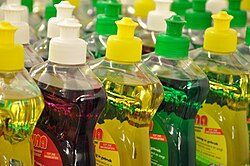{: .item-img loading="lazy" width="64" height="64"} Washing-up liquid
- 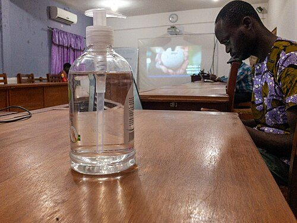{: .item-img loading="lazy" width="64" height="64"} Hand-wash gel
- 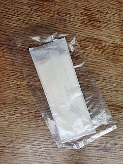{: .item-img loading="lazy" width="64" height="64"} Unscented wet wipes

### For the dogs

- 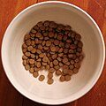{: .item-img loading="lazy" width="64" height="64"} Dog bowls
- 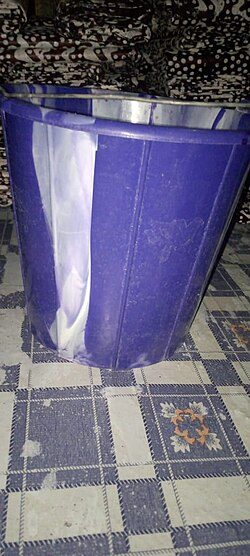{: .item-img loading="lazy" width="64" height="64"} A small water bucket

### For the evenings and getting about

- 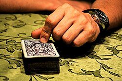{: .item-img loading="lazy" width="64" height="64"} A pack of playing cards
- 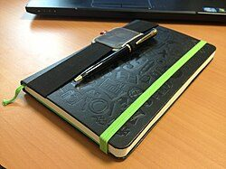{: .item-img loading="lazy" width="64" height="64"} Pen and paper
- 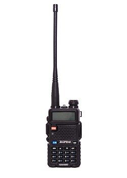{: .item-img loading="lazy" width="64" height="64"} A pair of [PMR446 walkie-talkies](/radio/446/), for keeping in touch on walks, at the beach or around a campsite

## Tips

- Pack it as soon as you get home from a trip, after everything has been washed, so it is ready for next time.
- Tape a list of the contents inside the lid, and tick things off as you pack up to leave, so nothing gets left behind.
- If you have the space, a few people also add tea and coffee, matches, bin bags and a roll of kitchen paper.

## Download a checklist

[Download the holiday let box checklist (Word, editable)](/assets/checklists/holiday-let-box-checklist.docx). It lists everything on this page with a tick box for each item and space to add your own. It opens in Word, Google Docs, Pages or LibreOffice. Print a copy and tape it inside the lid, then tick things off when you check or repack it.


