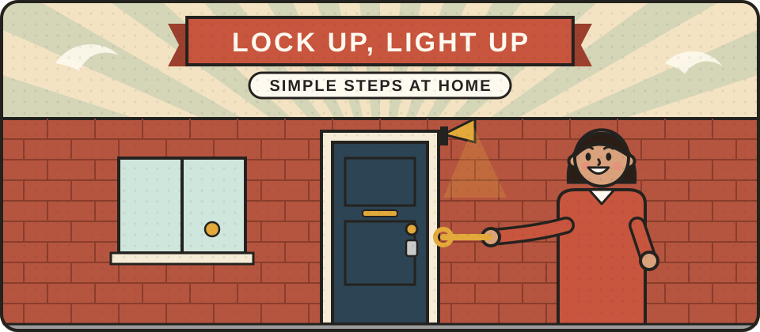

# Home safety

Most burglars look for an easy target: an unlocked door, a window left open, or a house that is obviously empty. A few simple, inexpensive steps make a home much less attractive and much safer. And in a crisis, fire is often a greater danger than crime, so home safety starts with alarms as well as locks.

<figure class="illustration"></figure>

## Can you help write this?

We are looking for crime prevention officers, locksmiths, fire safety advisers and others who can explain home security in plain English. If that could be you, please [get in touch](/get-involved/).

## What we hope to cover

- **Doors.** Good locks for wooden doors, and anti-snap cylinder locks for uPVC and composite doors. Look for locks that meet British Standards, and ask a locksmith if you are unsure.
- **Windows.** Window locks, and remembering to use them.
- **Keys.** Keeping keys away from the letterbox and out of sight, and never leaving them in the lock.
- **Lighting.** Outside lights, and timer switches so a home looks lived in.
- **Sheds and garages.** Locking away tools and ladders that could be used to break in.
- **Valuables.** Keeping them out of sight, and marking property so it can be traced.
- **Fire safety.** Smoke alarms on every floor, a carbon monoxide alarm, testing them monthly, and a plan for getting out.
- **Power cuts.** Staying safe with candles, heaters and cooking when the power is off.

See also [Secured by Design](https://www.securedbydesign.com/), the police's own guidance on home security.


