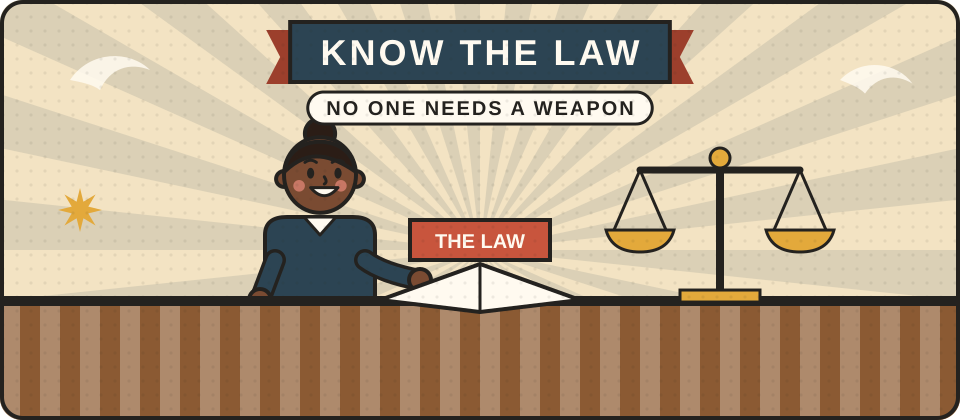

# Safety and the law

Many people misunderstand what UK law says about protecting yourself. This page gives a plain-English outline, so that no one ends up in trouble for trying to keep themselves safe.

<figure class="illustration"></figure>

This is a general outline, not legal advice. It mainly reflects the law in England and Wales. The law in Scotland and Northern Ireland is similar in many ways but not the same. This page has not yet been checked by a lawyer or police officer. If that could be you, please <a href="/get-involved/">get in touch</a>.

## You can use reasonable force

You are allowed to use reasonable force to protect yourself or someone else, to prevent a crime, or to protect your property. What counts as reasonable depends on the situation as you honestly believed it to be at the time. The law recognises that people in fear cannot weigh up their actions precisely.

If someone breaks into your home, the law gives householders more leeway. Force against an intruder is only treated as unreasonable if it is grossly out of proportion to the threat.

## You cannot carry a weapon

It is against the law to carry anything in public as a weapon, and wanting to defend yourself is not a lawful reason. In particular:

- **Pepper spray, CS spray and stun guns** are classed as prohibited weapons in the UK. Owning one, not just carrying it, is a serious offence.
- **Knives.** You can carry a small folding pocketknife with a blade under 3 inches (7.62 cm) that does not lock. Carrying any other knife in public needs a good reason, such as taking it to work or to a holiday cottage, and self-defence never counts.
- **Everyday objects** become offensive weapons in law if you carry them intending to use them to hurt someone.

## What you can carry

- **Personal alarms,** which make a loud noise to attract attention.
- **Marker or "criminal identifier" sprays,** which coat someone in coloured dye, are generally legal, as long as they contain nothing harmful.
- **A charged phone,** which is still the best safety tool most people have.

## Getting help

- **999** if someone is in danger or a crime is happening now. If you cannot speak, call from a mobile and press 55 when asked.
- **101** to report something that is not an emergency.
- **Crimestoppers** on 0800 555 111, to pass on information anonymously.


