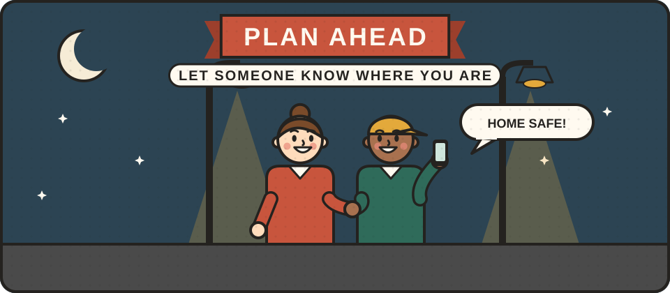

# Personal safety

Most of what keeps people safe when they are out and about is common sense: paying attention, planning ahead and letting someone know where you are. When trouble does start, the most useful skills are calming things down and getting away safely, not fighting. These skills can also help you protect others, such as someone being harassed on a bus.

<figure class="illustration"></figure>

## Can you help write this?

We are looking for personal safety trainers, people who teach de-escalation or breakaway techniques, Alternatives to Violence Project facilitators, and youth workers. If that could be you, please [get in touch](/get-involved/).

## What we hope to cover

- **Awareness.** Noticing what is going on around you, and trusting your instincts.
- **Planning ahead.** Telling someone where you are going, travelling with others after dark, and keeping your phone charged.
- **Calming things down.** How to speak, stand and listen so that a tense situation cools rather than flares, and when to walk away.
- **Helping others safely.** Bystander skills, such as the "5 Ds": distract, delegate, document, delay and direct.
- **Getting help on a night out.** Schemes such as "Ask for Angela" in pubs and bars.
- **Personal alarms.** Simple, legal devices that make a loud noise to draw attention and scare off an attacker.
- **Breakaway training.** Short courses that teach how to escape a grip and get away, rather than how to fight.
- **Martial arts.** Clubs such as judo and aikido, which build confidence, fitness and self-control.

See also the [Suzy Lamplugh Trust](https://www.suzylamplugh.org/), a UK charity for personal safety.




