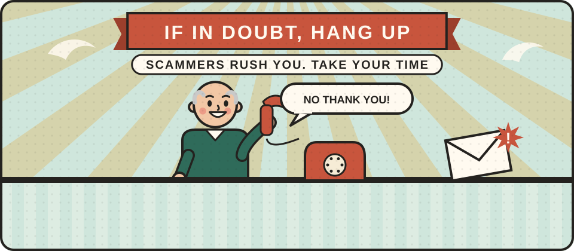

# Scams and fraud

Whenever people are frightened or in need, scammers follow. After floods, during the pandemic and in every crisis since, there have been fake charities, fake officials, fake tradespeople and fake messages offering help or demanding payment. Knowing the common tricks protects you and the people you care about, especially those who may be more vulnerable.

<figure class="illustration"></figure>

## Can you help write this?

We are looking for trading standards officers, bank fraud specialists, police and people who support scam victims. If that could be you, please [get in touch](/get-involved/).

## What we hope to cover

- **Common crisis scams.** Fake charity appeals, fake grants and refunds, bogus tradespeople offering repairs, and fake messages from banks, councils or delivery companies.
- **Stop, check, call.** Never act on an unexpected call, text or email. Hang up, and contact the organisation using a number you already know.
- **Your bank.** Call 159 to reach most UK banks safely if you think a call claiming to be from your bank is a scam.
- **Spam texts.** Forward suspicious texts to 7726, free of charge.
- **On the doorstep.** Checking identity, never paying up front, and saying no to pressure.
- **Looking out for others.** Helping older or isolated neighbours spot scams.
- **Reporting it.** Report fraud in England, Wales and Northern Ireland to [Report Fraud](https://www.reportfraud.police.uk/) on 0300 123 2040. In Scotland, report it to Police Scotland on 101.


