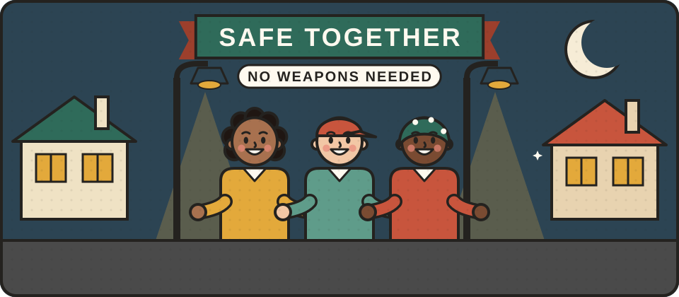

# Keeping each other safe

In hard times, people worry about their safety, and some start to think about arming themselves. We think that is the wrong answer, both in principle and in practice. In the UK, carrying anything as a weapon is against the law, even if you only mean to defend yourself. Weapons also tend to turn frightening situations into dangerous ones. The things that really keep people safe are much more ordinary: good locks, neighbours who know and look out for each other, the confidence to calm a tense situation or walk away from it, and a community where no one feels they have to face trouble alone.

<figure class="illustration"></figure>

This section covers [home safety](/staying-safe/home/), [community safety](/staying-safe/community/), [personal safety](/staying-safe/personal/), [what the law allows](/staying-safe/the-law/), [getting help with domestic abuse](/staying-safe/domestic-abuse/), and [avoiding scams and fraud](/staying-safe/scams/), which always rise when people are worried.

If you or someone else is in danger now, call 999. If you cannot speak, call 999 from a mobile and press 55 when asked, and the operator will know it is a real emergency. For non-emergencies, call the police on 101.




