# A travel bag that is always ready

A small bag kept packed and ready makes life easier in all sorts of ways. It takes the panic out of a last-minute trip, an unexpected night away, or a hospital stay with a relative. In an emergency, such as a flood warning or being asked to leave your home for a night or two, it means you can go in minutes, knowing you have the essentials.

The trick is to keep it separate from your everyday things, so it is never raided and left half-empty.

## What to keep in it

- 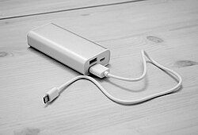{: .item-img loading="lazy" width="64" height="64"} **Phone charger and power bank,** kept charged.
- 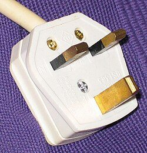{: .item-img loading="lazy" width="64" height="64"} **Plugs for everywhere you travel.** British, European and any other countries you visit often. Where you can, buy chargers with the right plug built in rather than relying on adapters, which are bulky and easy to lose.
- 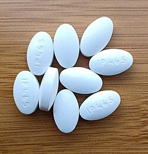{: .item-img loading="lazy" width="64" height="64"} **Everyday medicines.** Aspirin, paracetamol, ibuprofen, antacid, anti-diarrhoea tablets, hay fever tablets, and Day Nurse and Night Nurse.
- 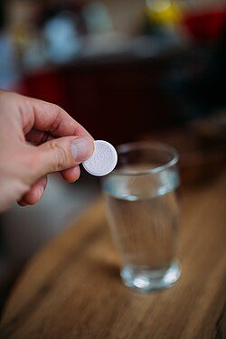{: .item-img loading="lazy" width="64" height="64"} **Rehydration or electrolyte tablets,** to replace lost salts and fluids after diarrhoea, sickness, heat or a long day's travel.
- **Your own medicines.** A few days' supply of anything you take regularly, plus a written list of your medicines and doses.
- 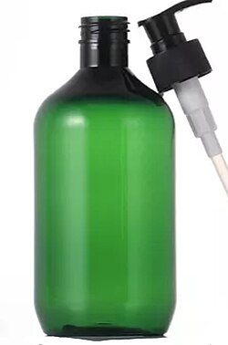{: .item-img loading="lazy" width="64" height="64"} **Toiletries in bottles of 100 ml or less,** so the bag can go through airport security as it is: soap, shampoo, conditioner, mouthwash and Pepto-Bismol, plus a spare toothbrush and toothpaste.
- 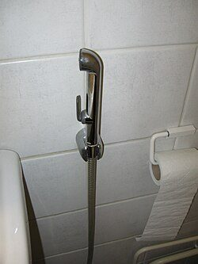{: .item-img loading="lazy" width="64" height="64"} **A portable bidet** (sometimes called a bum squirter). A small squeezable bottle with a nozzle that folds away into a washbag, for when toilet paper runs out or a proper wash is what you need.
- 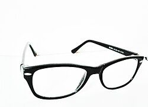{: .item-img loading="lazy" width="64" height="64"} **Glasses.** A spare pair, if you wear them.
- 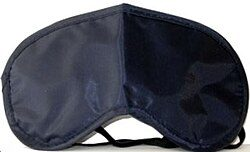{: .item-img loading="lazy" width="64" height="64"} **A sleep mask and earplugs,** for unfamiliar or noisy places.
- 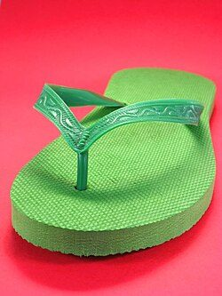{: .item-img loading="lazy" width="64" height="64"} **Flip-flops,** for hotel rooms, shared showers, the pool or the beach.
- 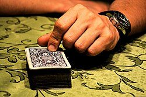{: .item-img loading="lazy" width="64" height="64"} **Playing cards, pen and paper,** for long waits and quiet evenings.
- **Cash.** A small amount in notes and coins, in case card machines are down.
- 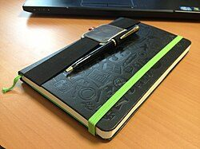{: .item-img loading="lazy" width="64" height="64"} **Contact numbers on paper,** in case your phone is lost or flat.
- 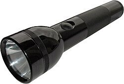{: .item-img loading="lazy" width="64" height="64"} **A small torch.**

Day Nurse and Night Nurse already contain paracetamol, so never take them with paracetamol tablets. Do not give aspirin or Pepto-Bismol to anyone under 16, and do not take Pepto-Bismol with aspirin. Read the labels, and ask a pharmacist if you are unsure. See our <a href="/health/first-aid/">first aid page</a> for more.

## Keeping it ready

- Check the bag every six months, and replace medicines before they go out of date.
- Put it back in the same place after every trip, topped up.
- If you have children or pets, keep a small bag ready for each of them too.

See also the [kit list](/be-ready/kit-list/) for useful things to keep at home.

## Download a checklist

[Download the travel bag checklist (Word, editable)](/assets/checklists/travel-bag-checklist.docx). It lists everything on this page with a tick box for each item and space to add your own. It opens in Word, Google Docs, Pages or LibreOffice. Print a copy and keep it in the bag, then tick things off when you check or repack it.


